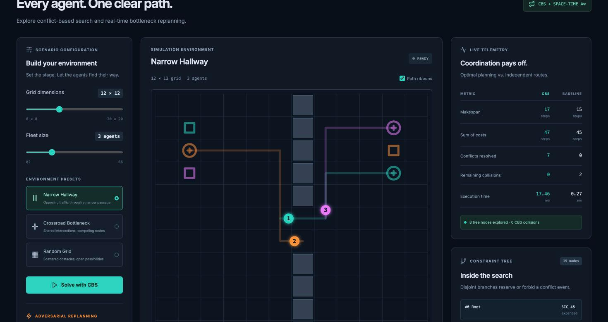

# Flux: Multi-Agent Pathfinding Lab

Interactive multi-agent pathfinding with Conflict-Based Search.

Flux plans collision-free routes for a fleet of agents on a 2D grid using **Conflict-Based Search (CBS)** over **space-time A\***. It compares the result against independent A\*, and lets you inject a temporary bottleneck mid-simulation to watch the fleet replan.



## Features

- **Optimal CBS** (minimum sum of costs) with disjoint positive/negative constraint splitting.
- **Space-time A\*** low-level planner supporting vertex constraints, edge-swap constraints, positive reservations, and permanent goal occupancy.
- **Dynamic bottleneck replanning:** blocks the busiest future cell for a few steps, then replans every agent from its current position.
- **Baseline comparison** against independent A\* (makespan, sum of costs, collisions, runtime).
- **Visualizer:** canvas simulation with path ribbons, playback scrubbing, step/rewind, speed control, and an expandable constraint-tree viewer.
- **Headless benchmark harness** with paired, per-process-isolated runs.

## Quick start

### Docker

```bash
docker compose up --build
```

Open http://localhost:5173. API docs are at http://localhost:8000/docs.

### Local (Python 3.12+, Node.js 22+)

Terminal 1:

```bash
python3 -m venv backend/.venv
backend/.venv/bin/python -m pip install -r backend/requirements.txt
cd backend && .venv/bin/python run.py
```

Terminal 2:

```bash
cd frontend && npm ci && npm run dev
```

Open http://localhost:5173.

## How it works

**Low level: space-time A\*.** States are `(x, y, t)`. Moves are the four cardinal directions plus wait. The heuristic is Manhattan distance, which is admissible. Agents remain at their goal after finishing, so a path is only complete once no later constraint touches the goal.

**High level: CBS.** A best-first search over a constraint tree, ordered by sum of costs. At each node the earliest vertex or edge-swap conflict is chosen and the node splits into two children: one that *forbids* the conflicting event for an agent, and one that *requires* it. The two branches partition the solution space without overlap. Only agents whose paths violate the new constraint are replanned.

**Dynamic bottleneck.** A deterministic traffic heuristic counts how often each future cell is visited, excluding occupied cells and goals. The busiest cell is blocked for 1 to 20 steps (default 4), and CBS replans from the agents' current positions. This is a heuristic, not a minimax or game-tree adversary.

## Benchmark results

360 random instances (grids 12/16/24, 2/4/6/8 agents, 10 seeds, 10/15/20% obstacles), each solver in its own process with a 5 s limit.

| | Independent A\* | CBS |
| --- | --- | --- |
| Pair/timestep collisions (358 paired runs) | 750 (602 vertex, 148 swap) | **0** |
| Sum-of-costs overhead vs. baseline | n/a | 0 to 2% mean per configuration |
| Success rate | n/a | 358 / 360 (2 timeouts, both with 6 to 8 agents on 16×16) |

Latency stays in the low milliseconds for most configurations. The slowest were 8 agents on 12×12 and 16×16 (mean about 26 to 37 ms, with a high variance and a worst-case mean of 72 ms in one density bucket). Full tables are in `backend/benchmark_results/benchmark_raw.csv`.

These are random, fairly sparse grids, so most instances need only a few constraint-tree nodes. The results show correctness and low overhead on this sample, not worst-case scaling.

Reproduce:

```bash
backend/.venv/bin/python backend/tests/benchmark.py --quick   # 36 instances
backend/.venv/bin/python backend/tests/benchmark.py --full    # 360 instances
```

## API

| Method | Path | Purpose |
| --- | --- | --- |
| `POST` | `/api/solve` | Solve a scenario with CBS and the baseline |
| `POST` | `/api/adversary/disrupt` | Inject a bottleneck and replan |
| `GET` | `/health` | Health check |

```json
POST /api/solve
{"width": 4, "height": 4, "obstacles": [],
 "agents": [{"id": "A1", "start": [0, 0], "goal": [3, 0]},
            {"id": "A2", "start": [3, 0], "goal": [0, 0]}]}
```

The response includes paths, metrics, baseline paths and metrics, the constraint tree, expanded node count, and solve time. Validation and search failures return `422`. Limits: grids 4 to 24 per side, 2 to 6 agents, 10,000 high-level expansions or 8 s per request.

## Project structure

```
backend/
  app/core/        space_time_astar.py, cbs.py, adversary.py, baseline_astar.py
  app/api/         FastAPI routes
  app/models/      Pydantic schemas
  tests/           planner, API, and benchmark tests + benchmark.py
  benchmark_results/
frontend/
  src/             React + TypeScript UI (canvas, telemetry, constraint tree)
  tests/           Playwright end-to-end tests
docker-compose.yml
```

## Testing

```bash
cd backend && .venv/bin/python -m pytest -q           # backend
cd frontend && npm run build                          # type-check + production build
cd frontend && npx playwright install chromium && npm run test:e2e
```

## Limitations and future work

- Plain CBS with no conflict prioritization (cardinal/semi-cardinal conflicts) or other ICBS improvements, so it scales to roughly 8 agents, not dozens.
- The baseline is independent A\*, which ignores collisions by design. Comparing against prioritized planning would be more informative.
- The adversary is a traffic heuristic. A true minimax or game-theoretic adversary is future work.
- The API is stateless with no authentication or rate limiting. Add both before exposing it publicly.

## Tech stack

Python, FastAPI, Pydantic, NumPy · React, TypeScript, Vite, Tailwind CSS, HTML5 Canvas · Docker, Nginx · pytest, Playwright
